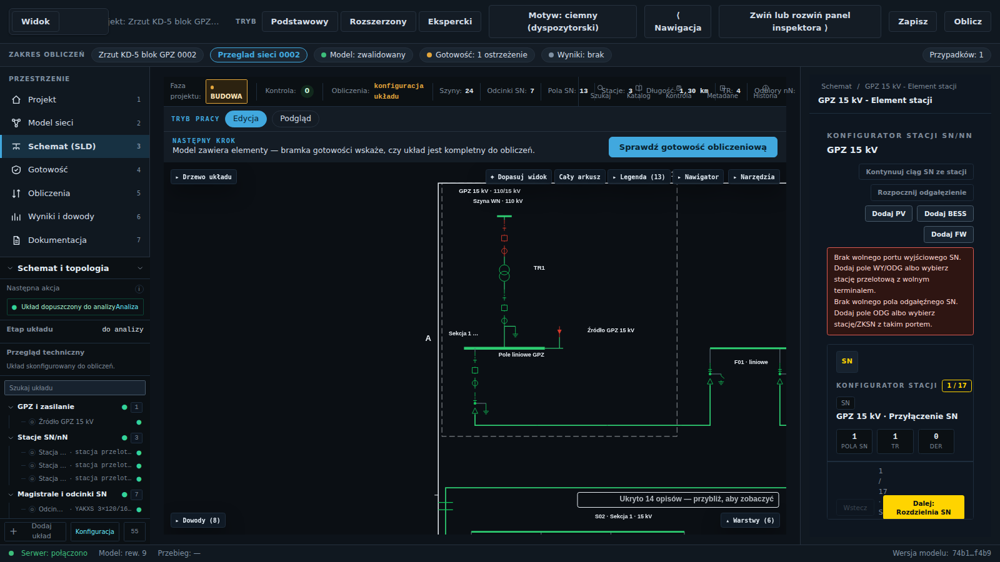
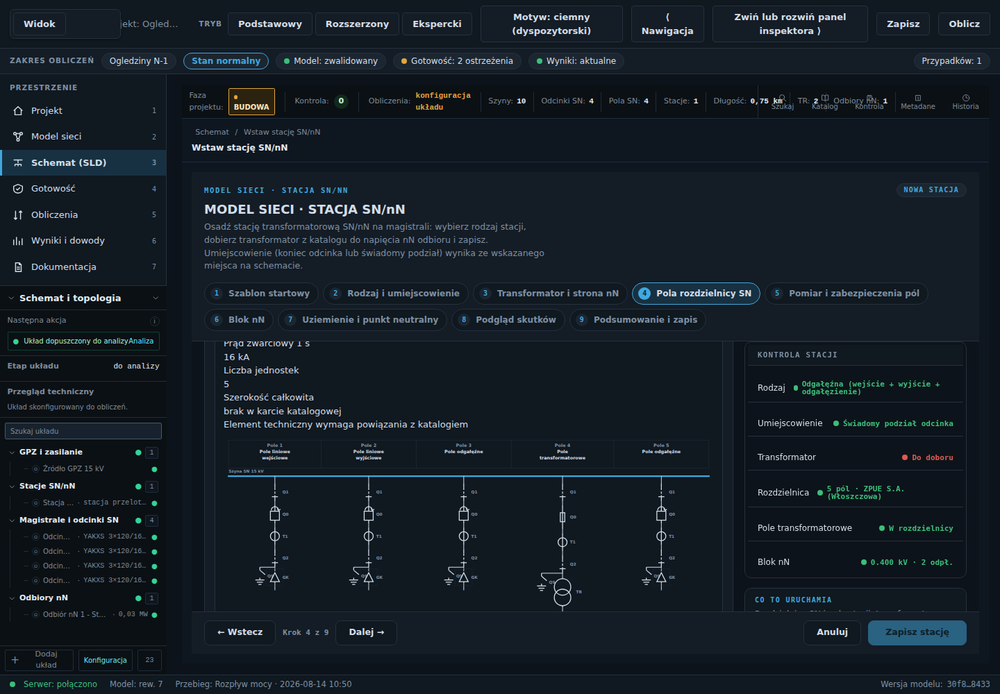
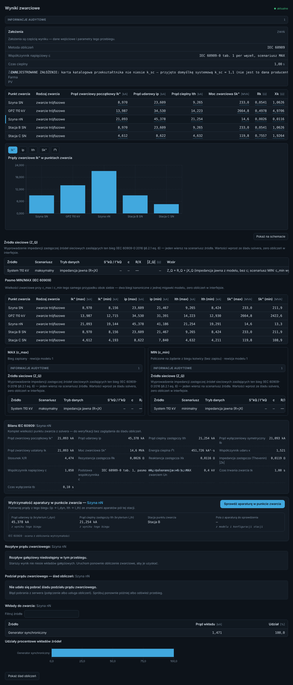

# GALERIA I FILMY — SEL Blueframe ↔ MV-DESIGN PRO

**Zastosowanie:** przegląd porównawczy, otwierany bezpośrednio przez Opusa w GitHub; nie są to makiety projektu ani zaakceptowane przez właściciela ekrany.

## A. Oryginalne zrzuty SEL — podgląd bezpośrednio w Markdown

### SEL-01 · Edytor Power System Model — wzorzec P0
[Otwórz obraz w pełnym rozmiarze](https://images.contentstack.io/v3/assets/bltea08f3d94a418a1b/bltba4c1b6c32e3f833/695bfeb7a078d06cb2309b97/PSM-dark.png) · [Opis funkcji PSM u producenta](https://selinc.com/software/distribution-management-system-dms/details/)

**Zanotować:** widoczne plusy w punktach połączenia, wskazanie transformatora i jego parametrów, hierarchię po lewej, Draft/Publish/Discard, dolną walidację. **SEL potwierdza** Autodirected Layout (wybór typu w nowym punkcie połączenia i automatyczny układ). Nie przypisywać widocznej ikonie niezweryfikowanych gestów.

### SEL-02 · Mapowanie modelu MDI — tylko P3
[Otwórz obraz](https://images.contentstack.io/v3/assets/bltea08f3d94a418a1b/blt7ae85d7034e506c4/695bfeb755a900b10a8a81c1/MDI-dark.png) · [Opis](https://selinc.com/software/distribution-management-system-dms/details/)

**GIS i mapowanie mapy odłożyć.** Wcześniej można zastosować tylko ogólną zasadę widocznego źródła wartości i kontroli danych, bez nowego importera GIS.

### SEL-03 · FLISR — topologia i stany sieci, inspiracja P1
[Otwórz obraz](https://images.contentstack.io/v3/assets/bltea08f3d94a418a1b/blt90f29d9a8834fecd/695bfe3becf29bad243a3463/FLISR-Fault.png) · [Opis](https://selinc.com/software/distribution-management-system-dms/details/)

**Inspiracja:** czytelny stan urządzeń i skutki zmian konfiguracji. **Nie kopiować funkcji sterowania realną siecią.**

### SEL-04 · Wyniki stanu sieci przed i po przełączeniu
[Otwórz obraz](https://selinc.com/v3/assets/bltea08f3d94a418a1b/blt1bf1596aac1f8b53/6904ef3de09550c3568419b8/Blueframe_DMS_Graphical-feeder-state-diagrams.jpg?auto=webp&content_type=image%2Fjpeg&disable=upscale&environment=production&quality=75&width=3840) · [Raporty](https://selinc.com/software/distribution-management-system-dms/details/)

**Inspiracja P1:** porównanie dwóch *projektowych* wariantów ENM z osobnymi wynikami solverów.

### SEL-05 · Tabela urządzeń przed i po rekonfiguracji
[Otwórz obraz](https://selinc.com/v3/assets/bltea08f3d94a418a1b/blta77da0cde4246222/6904ef6af1ca7c4f93b6fcee/Blueframe_DMS_Device_Details.jpg?auto=webp&content_type=image%2Fjpeg&disable=upscale&environment=production&quality=75&width=1080)

**Inspiracja P1:** zestawienie stanów i parametrów, nie algorytm automatyki FLISR.

---

## B. Nasze rzeczywiste zrzuty do porównania (już w repo)

Wszystkie poniższe linki są **lokalne względem repo**; obraz wyświetla się w GitHub bez dodatkowego pobierania. Właściwy plik produkcyjny nie jest tworzony ponownie.

| Temat | Zrzut MV-DESIGN PRO | Na co patrzeć podczas porównania |
|---|---|---|
| SLD GPZ / model sieci | [ekran GPZ](../../audit/visual/flow-ekspert/kd5-gpz-rozwiniety-dark.png) | skala SLD, miejsce pracy projektanta, panel zbyt rozbudowany |
| Konfigurator stacji SN/nN | [stacja modularna](../../audit/visual/konfigurator/konf-modularny-podglad-dark.png) | czy da się edytować z inspektora zamiast przechodzić przez kroki |
| Kreator PV/BESS/FW | [kreator OZE](../../audit/visual/kreatory/kreator_oze_dark.png) | dołączenie z portu pola i źródło parametrów katalogowych |
| SLD nN z PV/BESS | [pełny tor OZE](../../audit/visual/nn/12_der_full_path_dark.png) | osobna projekcja nN, brak mieszanej kanwy |
| Zwarcia | [ekran wyników](../../audit/visual/wspolczynnik_c/po_ekran_zwarc_ciemny.png) | nakładka wyników i White Box bez zasłaniania SLD |
| Rozpływ mocy | [wyniki gałęzi](../../audit/visual/flow-ekspert/flow_rozplyw_dark.png) | dane gałęzi i nawigacja wynik → element na SLD |
| Zabezpieczenia | [ocena z modelu](../../audit/visual/flow-ekspert/ocena-zabezpieczen-z-modelu-dark.png) | tożsamość pola, prąd, nastawa, czas, dowód |
| Pulpit projektu | [pulpit](../../audit/visual/flow-ekspert/flow_pulpit_dark.png) | redukcja niepotrzebnych kart; wejście w schemat |
| Motyw jasny i ciemny | [GPZ jasny](../../audit/visual/flow-ekspert/kd5-gpz-rozwiniety-light.png) / [GPZ ciemny](../../audit/visual/flow-ekspert/kd5-gpz-rozwiniety-dark.png) | identyczne rozmieszczenie i pełna czytelność |
| Walidacja stacji nN | [TT/IT — panel](../../audit/visual/w5e_ttit/02_panel_odplywu_werdykt_tt_po_dark.png) | błędy i wskazanie miejsca naprawy |

**Porównanie podstawowe do obejrzenia tu, bez szukania plików:**

**MV-01 — GPZ / SLD**

**MV-02 — konfigurator stacji**

**MV-03 — wyniki zwarć**

---

## C. Oficjalne filmy — konkretne adresy i cel przeglądu

**Status źródeł:** zweryfikowano istnienie oficjalnych stron i zakres deklarowany przez producenta; **nie wykonano pełnej analizy klatka po klatce**. Nie fabrykować znaczników czasu ani sekwencji kliknięć. Przy właściwym oglądaniu przez Opusa dopisać rzeczywiste timestampy w odrębnym rejestrze.

| ID | Film (oryginalny link) | Czego szukać | Priorytet |
|---|---|---|---|
| V01 | [PSM — Power System Model](https://video.selinc.com/support/detail/video/1740181918198970918/sel-dms%E2%80%94power-system-model-psm) | plus, dodawanie elementów, usytuowanie, edycja, walidacja | **P0** |
| V02 | [FLISR Simulator](https://video.selinc.com/support/detail/video/1740182438591478732/sel-dms%E2%80%94flisr-simulator) | test wariantu bez wpływu na sieć | P1 |
| V03 | [FLISR Configuration and Deployment](https://video.selinc.com/support/detail/videos/general/video/1740182184300289400/dms-flisr-%E2%80%93-dnp-configuration) | konfiguracja i zatwierdzanie | P1/tylko UX |
| V04 | [A Next-Generation FLISR Solution](https://video.selinc.com/support/detail/video/1734570082740157488/a-next-generation-flisr-solution) | układ paneli i statusy | P1 |
| V05 | [Using Protocol Services Templates](https://video.selinc.com/detail/video/1847795549871542433/sel-dms%3A-using-protocol-services-templates-in-flisr) | instancje wielokrotnie użytych szablonów | P2 (bez DNP3) |
| V06 | [Resource Management](https://video.selinc.com/support/detail/video/1696237326719391261/sel-blueframe%3A-resource-management) | drzewo zasobów, grupowanie | P1/P2 |
| V07 | [Profile Instances](https://video.selinc.com/support/detail/video/1749062658231707809/sel-blueframe%E2%80%94profile-instances) | katalog → profil → instancja | P2 |
| V08 | [Importing Resources](https://video.selinc.com/support/detail/video/1749062651703381945/sel-blueframe%E2%80%94importing-resources) | spójność mapowania i danych | P2 |
| V09 | [Associating Child Resources](https://video.selinc.com/support/detail/video/1757115039643287386/sel-blueframe%3A-associating-child-resources-in-resource-management) | powiązanie obiektów rodzic–dziecko | P2 |
| V10 | [Model Data Import (MDI)](https://video.selinc.com/support/detail/video/1738907372737246376/sel-dms%E2%80%94model-data-import-mdi) | GIS/GeoJSON, mapowanie, walidacja | **P3 / NIE TERAZ** |
| V11 | [Configuring DNP3 Map in FLISR](https://video.selinc.com/support/detail/video/1835284020918692830/sel-dms%3A-configuring-the-dnp3-map-in-flisr) | relacje punkt–aparat wyłącznie jako wzorzec danych | **P3 / NIE TERAZ** |

Zbiorcze [SEL DMS — wszystkie funkcje i obrazy](https://selinc.com/software/distribution-management-system-dms/details/).

## GIS — WYŁĄCZNIE WZORZEC PRZYSZŁOŚCI

SEL MDI prezentuje bardzo dobry wzorzec mapowania danych geograficznych, ale **GIS NIE JEST PRIORYTETEM wdrożeniowym**. W tym zleceniu zakazane jest rozpoczynanie modułu GIS, nowych ekranów map, własnego modelu geograficznego, importu GeoJSON/DXF, map podkładowych lub przepinania priorytetów P0/P1 na GIS. Warto zachować link V10 i ekran SEL-02 jako materiał referencyjny do odrębnej przyszłej decyzji właściciela.

## Źródła i prawa autorskie

Materiały SEL i obrazy osadzone są z **oryginalnych publicznych adresów producenta**; nie stanowią licencjonowanych zasobów repozytorium i nie mogą być użyte w wydawanej aplikacji jako element interfejsu. Wszystkie prawa producenta zastrzeżone. Zrzuty MV są tylko linkami do już istniejących własnych plików repozytorium.
